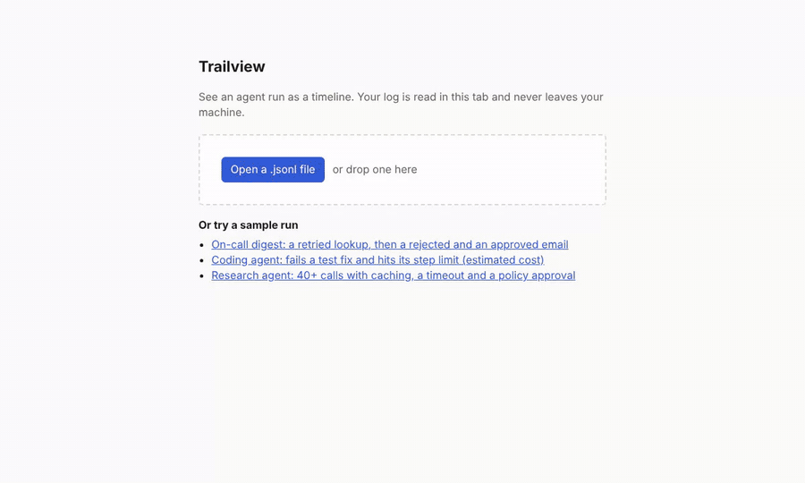

# Trailview

Trailview is an open-source viewer for AI-agent runs. Load a run log and see it as a timeline: steps, model calls, tool calls with their inputs and outputs, tokens and cost, errors and retries, and the points where a person approved or rejected an action.

It runs entirely in your browser, locally or as a static site. There is no account, no server and no API key, and your logs never leave your machine.



**Live demo:** coming with the first deploy. In the demo you pick a sample run or drop your own `.jsonl` file; it is read in the tab and never uploaded.

## Quick start

Open the demo and drop a JSONL log on it, or run it locally:

```sh
git clone https://github.com/Chi944/trailview
cd trailview
npm install
npm run dev
```

Then open http://localhost:5173 and load a file. Press `?` for keyboard shortcuts: `j`/`k` move, `Enter` opens a step, `e` toggles errors only, `/` searches.

## Log format

Trailview reads its own JSONL format, one JSON event per line, and OpenTelemetry traces exported as OTLP JSON that follow the GenAI semantic conventions. It detects which one a file is from its content. See [docs/schema.md](docs/schema.md) for the format and the OpenTelemetry mapping, and [samples/](samples/) for example runs.

## Development

| Command | What it does |
|---|---|
| `npm run dev` | Start the dev server |
| `npm test` | Run the unit tests (Vitest) |
| `npm run e2e` | Run the browser tests, including an axe accessibility scan (Playwright) |
| `npm run typecheck` | Type-check with TypeScript |
| `npm run lint` | Lint with ESLint |
| `npm run build` | Build the static site into `dist/` |

## Licence

[MIT](LICENSE)
